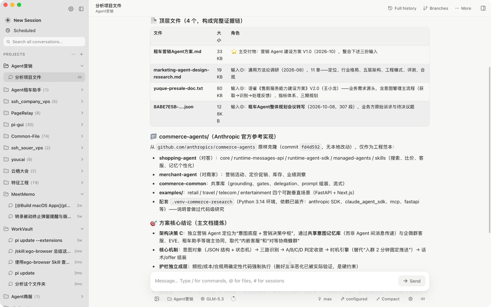
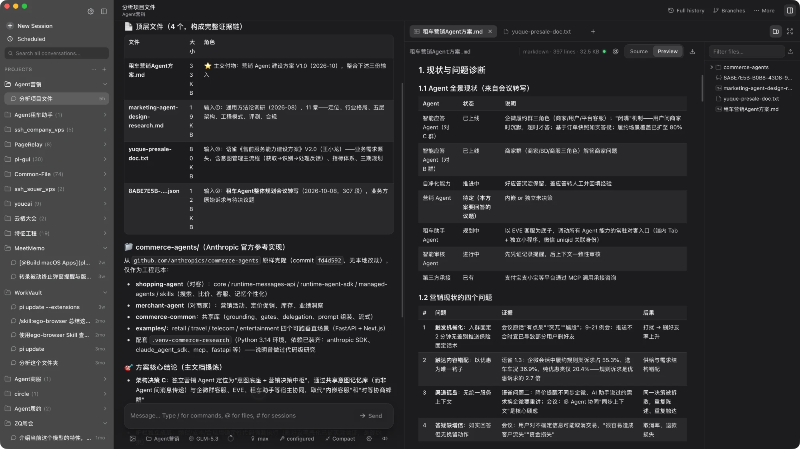

# Pi Agent · Claude-style edition

**English** | [简体中文](./README.zh-CN.md)

This is a personal fork of [abcwyc/pi-agent-desktop](https://github.com/abcwyc/pi-agent-desktop), adding a Claude-style interface, a pixel crab companion, a home usage dashboard, and custom project display names to the existing Pi Agent desktop app. The agent runtime remains powered by [pi](https://github.com/earendil-works/pi).

[This repository](https://github.com/2856754968/pi-agent-desktop) · [Cloud builds](https://github.com/2856754968/pi-agent-desktop/actions/workflows/desktop-test-build.yml) · [Original repository](https://github.com/abcwyc/pi-agent-desktop)

## What's changed in this edition

| Change | Experience |
| --- | --- |
| Claude-style interface | Warm light and dark palettes, terracotta controls, updated sidebar, composer and message bubbles, and revised prose typography. |
| Pixel crab companion | Animations follow agent thinking, output, tool execution, compaction and errors. Click to interact or drag horizontally above the composer. |
| Home usage dashboard | Local session statistics, a 26-week token heatmap, 30-day per-model usage trends, model rankings, and book equivalents for token totals. |
| Character ripple background | Click empty areas of the home screen to create waves. Rendering pauses while hidden and respects reduced motion. |
| Reasoning slider | A slider inside the existing reasoning menu exposes levels supported by the selected model while retaining the original option rows. |
| Message motion and home layout | Locally submitted user messages animate into view; the dashboard sits above the composer. Loading history does not replay entrance animations. |
| Project renaming | Use a sidebar project's **… → Rename project** action to set a display name shared by the sidebar, timeline and project selectors. Project filtering also searches the new name. |

The home dashboard and companion are on by default and can be disabled in Settings; previously saved opt-out preferences remain respected. Statistics are derived from local session history without uploading session content for analytics.

Renaming changes the display name only. Folder, Git repository, session and worktree paths stay the same. Names and removed-project markers are saved in `~/.pi/agent/pi-web/projects.json`, so desktop restarts and local server port changes preserve them. Save an empty name to restore the default. Existing browser preferences migrate on first use when available; these settings do not automatically sync across devices.

The visuals and animations draw on [Nwflower/dsh-claude-style](https://github.com/Nwflower/dsh-claude-style), adapted to Pi Agent's existing components and usage data. See [third-party notices](./public/THIRD_PARTY_NOTICES.txt).

## Retained upstream features

- Browse and resume past Pi sessions by project, without digging through terminal history or `.jsonl` files.
- Talk to the agent in real time inside a desktop window, with thinking, tool calls, context usage, cost, and compaction state all visible.
- Continue from any earlier message as a branch, or fork the conversation into an independent session.
- Manage models, OAuth/API keys, custom model configuration, skills, and plugins.
- Switch Git worktrees from the sidebar and browse project files.
- Scheduled tasks: run a saved prompt in a new session on a schedule (hourly, daily, weekly, a custom cron expression, or once). They run while the app is open, even with its window hidden, default to read-only tools, catch up once after a sleep, and notify you when a run succeeds or fails.
- Preview source code, diffs, Markdown, images, audio, PDF, and DOCX files.
- Dark mode, automatic session naming, a completion sound, and restored run state.
- A weekly check of the latest stable `pi-agent-desktop` GitHub Release, with an in-app notice only when the installed app is older.
- One upgrade button installs a complete, signed new build of Pi Agent and restarts automatically.

The following upstream screenshots illustrate the original layout, rather than the current appearance of this edition.





**[Build this edition with GitHub Actions](https://github.com/2856754968/pi-agent-desktop/actions/workflows/desktop-test-build.yml)**

[Official upstream releases](https://github.com/abcwyc/pi-agent-desktop/releases) are published by the original project and do not include this fork's additions.

## Installation And Usage

### Build this edition with GitHub Actions

1. Commit and push the feature code, theme and assets to this repository's `develop` branch.
2. Open [Actions → Desktop test build](https://github.com/2856754968/pi-agent-desktop/actions/workflows/desktop-test-build.yml) and choose **Run workflow → develop**.
3. Enter a version suffix such as `claude-style.1` and start the build.
4. Download and extract the matching platform artifact from the completed run's **Artifacts** section. Windows uses `x64-setup.exe`; the other platform packages are an Apple Silicon DMG and a Linux x64 DEB.

The workflow builds the remote commit, so local files that have not been committed and pushed are not included. It uploads test installers without creating a release, tag or updater manifest. To update this edition, merge upstream changes, rebuild and install the new package.

### Install the upstream desktop app

The following methods install the original upstream app without this edition's additions. Builds are available from [GitHub Releases](https://github.com/abcwyc/pi-agent-desktop/releases):

- Apple Silicon Mac: download the `aarch64.dmg`, open it, and drag the app into `Applications`. Official releases do not build for Intel Macs.
- Apple Silicon Mac with [Homebrew](https://brew.sh): install from this repository's tap. The tap is added from the repo URL, so the first command is needed once:

  ```bash
  brew tap abcwyc/pi-agent-desktop https://github.com/abcwyc/pi-agent-desktop
  brew install --cask pi-agent
  ```

  The app upgrades itself from Settings, so `brew upgrade` leaves it alone unless you pass `--greedy`. `brew uninstall --cask --zap pi-agent` removes the app and its window state but never `~/.pi`, which the pi CLI shares.
- Linux x64: download the `.deb` package and install it with your distribution's package manager. A community-maintained Flatpak is also available at [flatpark.org](https://flatpark.org/apps/io.github.abcwyc.pi-agent-desktop/) — not an official release, but Flatpak works across most distributions and handles updates for you.

- Windows x64: download the installer whose name ends in `x64-setup.exe` and run it. The installer pulls in Microsoft WebView2 when it is missing.

Official releases support Apple Silicon Macs running macOS 11 or later, Windows 10/11 x64, and Linux x64 distributions with WebKitGTK 4.1 and GTK 3. The desktop package bundles the Next.js server, the Node.js runtime, and the current Pi SDK, so the local server starts with the app — no separate terminal, Node.js installation, or manually started web server is required.

> Installing Pi Agent gives you the agent inside the app, but it does not install a global `pi` command. If you also want the Pi CLI in your terminal, install it separately by following the [pi project](https://github.com/earendil-works/pi) instructions.

> **macOS blocks the first launch**: the macOS build is not yet signed with an Apple Developer ID or notarized, so Gatekeeper may say the developer cannot be verified or that the app "is damaged and can't be opened" (Homebrew installs included). Click "Open Anyway" in System Settings › Privacy & Security, or run:
>
> ```bash
> xattr -dr com.apple.quarantine "/Applications/Pi Agent.app"
> ```

Before signed auto-updates can be used for the first time, an older build without the updater has to be replaced by manually installing a signed one. Upgrades then happen from Settings.

### Use Existing Pi Data

Pi Agent reads Pi's local data directory by default:

```text
~/.pi/agent/
```

Sessions normally live under:

```text
~/.pi/agent/sessions/<encoded-cwd>/<timestamp>_<uuid>.jsonl
```

If you have used Pi on this machine before, the app picks up your existing sessions, models, and authentication after installation. Set `PI_CODING_AGENT_DIR` to point at a different Pi agent data directory.

Model keys and session data stay on your machine. The file-browsing API only allows access to the current session, the selected project, and explicitly authorized working directories.

## Update Checks And Upgrades

This section describes the inherited upstream release mechanism. This fork's Actions test builds are outside that update channel: rebuild and install to update the customized edition. New upstream releases are not automatically merged into this repository.

Pi Agent checks the latest stable release of `abcwyc/pi-agent-desktop` at most once every seven days:

- `abcwyc/pi-agent-desktop`
- `earendil-works/pi`
- `agegr/pi-web`

The versioning and upgrade rules are:

1. The latest stable `pi-agent-desktop` release is the only source used for update reminders.
2. The upgrade button in Settings becomes enabled only when the installed desktop app version is older.
3. When several components need updating, the release automation syncs and verifies them in the order `pi → pi-web → pi-agent-desktop`.
4. Nothing patches an individual JavaScript package inside an installed app. The app downloads one complete signed build containing all three components at their latest versions.
5. The app restarts after installation, so all three components land in the same verified release state at once.

This keeps the components in a desktop install consistent, and avoids the runtime incompatibilities that come from swapping `pi` or `pi-web` on their own.

If a new upstream version has been detected but the signed `pi-agent-desktop` release containing it is not published yet, Settings says that no signed complete build is installable for now. The app never falls back to downloading unsigned files or partially overwriting dependencies.

The full sync, signing, and release configuration is described in [Desktop updates and releases](./docs/desktop-updates.md).

## HTTP Proxy

Server-side model and API requests honor the standard `HTTP_PROXY`, `HTTPS_PROXY`, and `NO_PROXY` environment variables. For example, when starting the dev server from a terminal:

```bash
HTTP_PROXY=http://127.0.0.1:7890 \
HTTPS_PROXY=http://127.0.0.1:7890 \
NO_PROXY=localhost,127.0.0.1 \
npm run dev
```

## Local Development

### Requirements

- macOS 11+ (Apple Silicon), Windows 10/11 x64, or Linux x64 with WebKitGTK 4.1 and GTK 3
- Node.js 22 (recommended)
- npm
- Rust 1.85+
- macOS: Xcode Command Line Tools
- Windows: Microsoft C++ Build Tools and WebView2
- Linux: GTK/WebKitGTK development packages

### Start The Web Dev Server

```bash
npm install
npm run dev
```

The dev server runs at [http://localhost:30141](http://localhost:30141) and does not open a browser. `npm run web` starts the same loopback server and opens `http://127.0.0.1:30141` in the desktop browser after it is ready. From WSL that is the Windows browser. See [Web profile](./docs/web-profile.md).

Do not run `next build` or `npm run build` during normal development. They write into `.next/` and can disrupt a running dev server; production builds are done by the desktop preparation script or by CI.

### Network Exposure (LAN)

`npm run dev` and `npm start` listen on `127.0.0.1` only. `npm run dev:lan`, `npm run start:lan` and `pi-web -H 0.0.0.0` listen on every interface. Pi Agent can run shell commands (the terminal tab and the agent's own tools) and read files as you, so **anyone who can reach the port gets the same access**. Before using a LAN mode, set a password:

```bash
PI_WEB_PASSWORD='choose-a-long-passphrase' npm run dev:lan
```

With `PI_WEB_PASSWORD` set, the browser asks for it on first visit and failed attempts are throttled. The connection is still plain HTTP, so put it behind HTTPS or a trusted VPN, and use `PI_WEB_ALLOWED_HOSTS` (comma-separated) to allow a DNS name other than an IP address. Without a password the launcher refuses to listen beyond loopback; on a network you trust, `PI_WEB_ALLOW_UNAUTHENTICATED=1` starts it anyway with a warning. The packaged desktop app is unaffected: it binds to loopback and authenticates the WebView with a per-process token.

### Start Desktop Dev Mode

```bash
npm run desktop:dev
```

This starts the existing Next.js dev server and opens it in a native Tauri window, without producing an installer.

### Common Checks

```bash
# Node tests (identical to the CI sync gate, including components/ tests)
npm test

# TypeScript
node_modules/.bin/tsc --noEmit

# ESLint and the branding protection test
npm run lint

# Divergence from pi-web upstream, split into "styling" and "structural" changes
npm run drift

# Rust/Tauri
cargo fmt --check --manifest-path src-tauri/Cargo.toml
cargo clippy --manifest-path src-tauri/Cargo.toml -- -D warnings

# Verify the bundled components match the latest stable releases
npm run release:verify
```

`release:verify` reaches GitHub and requires the bundled `pi` and `pi-web` to match their latest stable releases exactly, while also checking the component manifest against the actual dependencies.

## Desktop Packaging

```bash
npm run desktop:build
```

The desktop build:

1. Generates the Next.js standalone server in an isolated directory.
2. Bundles the Node.js runtime for the current architecture.
3. Places the server and runtime into the app as Tauri resources.
4. Produces `.app`, `.dmg`, and updater artifacts on Apple Silicon Macs; an NSIS `-setup.exe` plus updater artifacts on Windows x64; and a `.deb` package on Linux x64.

On Linux, the package requires a WebKitGTK 4.1 runtime and GTK 3. It includes the Node.js runtime, so users do not need to install Node.js separately.

Local builds do not register the production updater and cannot accept official updates. Official releases must inject the updater public key through GitHub Actions and sign with the matching private key.

## Upstream Sync And Releases

### Maintaining this edition

The direct upstream of this fork is `abcwyc/pi-agent-desktop`. Commit current work first, then merge upstream updates into `develop`:

```bash
git switch develop
git fetch upstream
git merge upstream/main
```

The `upstream` remote should point to `https://github.com/abcwyc/pi-agent-desktop.git`. Review the chat window, composer and sidebar to confirm that the theme, home components and project renaming still work. Run the relevant checks, push only to `origin/develop`, then start a test build. Resolve conflicts individually and inspect the rendered UI even after a conflict-free merge.

### Inherited component sync and official releases

The workflows below sync `pi`/`pi-web` components and publish official releases; they do not replace the manual merge from `abcwyc/pi-agent-desktop` above. Their operation in a fork depends on Actions being enabled, permissions and signing configuration.

The repository contains two chained automation workflows:

- [`component-updates.yml`](./.github/workflows/component-updates.yml): checks the stable releases of `pi` and `pi-web` daily. When a new version appears, it **first** intersects the incoming upstream changeset with the "upstream files this fork has modified" recorded in [`scripts/fork-ownership.json`](./scripts/fork-ownership.json), then merges the tag, updates dependencies and the component manifest, and runs the full gate (`npm test`, `tsc`, `lint`, a real standalone build).
  - Empty intersection → commits to `main` and triggers a release.
  - High or medium risk files hit → pushes a `sync/pi-web-<tag>` branch and opens a PR with the boundary report, and does **not** trigger a release. Merging that PR is what ships a version.
- [`release.yml`](./.github/workflows/release.yml): after an explicit trigger from the component sync workflow, serially builds the Apple Silicon (`aarch64`) DMG, the Linux x64 `.deb`, and the Windows x64 NSIS `-setup.exe`. No Intel Mac build is produced. The release stays a draft until the updater signature files, `latest.json`, and the component manifest for all platforms are uploaded — the `manifest` job depends on the **entire** build matrix, so a failure on any platform keeps it from being published. Build failures create or update a `release-failure` issue.

Upstream sync uses a Git merge, so this fork's Pi Agent branding, settings entry points, and upgrade logic survive as local modifications. Merge conflicts stop the workflow, which is the safe failure mode. The genuinely dangerous case is a **conflict-free but semantically wrong** merge: upstream changed a region this fork also changed, Git merged it cleanly, and the tests still pass. The boundary intersection above exists for exactly that case; the rules are in [Ownership boundaries](./docs/ownership-boundaries.md).

A failed sync creates or updates a `component-sync-failure` issue, so nothing piles up silently.

An official release additionally requires:

- Tauri updater key pair.
- Apple Developer ID signing and notarization for distribution to external users.
- Authenticode code signing is recommended for Windows distribution to external users; an unsigned `.exe` can trigger SmartScreen warnings.

## Project Structure

```text
app/
  api/                  Next.js APIs: agent, sessions, models, files, update checks
components/             Pages, chat, sidebar, settings, and version notices
hooks/                  Client state: session streams, audio, drag and drop, theme
lib/                    AgentSession, HTTP proxy, session reading, file security, upgrade logic
scripts/                Desktop packaging, component version sync, release verification
src-tauri/
  capabilities/         Tauri permission configuration
  resources/            Desktop resources and the component version manifest
  src/                  Desktop window, local server, and updater registration
.github/workflows/      Daily component sync and desktop release automation
instrumentation.ts     Next.js server-side HTTP proxy initialization
```

## Related Documents

- [Ownership boundaries](./docs/ownership-boundaries.md) — the split with `pi-web` upstream, the rules for editing shared files, and how the automated sync decides
- [Desktop updates and releases](./docs/desktop-updates.md)
- [Git worktrees](./docs/worktrees.md)
- [Pi session and project architecture](./AGENTS.md)

## Credits And License

This edition is based on [abcwyc/pi-agent-desktop](https://github.com/abcwyc/pi-agent-desktop). Its Claude-style home, animation and related assets draw on [Nwflower/dsh-claude-style](https://github.com/Nwflower/dsh-claude-style). The Clawd character and artwork remain the property of Anthropic and are not covered by the code's MIT license. This is an unofficial adaptation, not endorsed by Anthropic; proprietary fonts and the Sodium engine are not bundled. Retain the [asset license and notices](./public/claude-companion/NOTICE.txt).

The desktop integration of Pi Agent is provided by `pi-agent-desktop`; the core capabilities and the web interface come from [earendil-works/pi](https://github.com/earendil-works/pi) and [agegr/pi-web](https://github.com/agegr/pi-web) respectively. Thanks to those projects and their contributors.

Code in the root of this repository is under the MIT License in [`LICENSE`](./LICENSE). The code and dependencies of the three component projects remain subject to the licenses of their own repositories; keep the corresponding copyright and license notices when copying, modifying, or redistributing.
